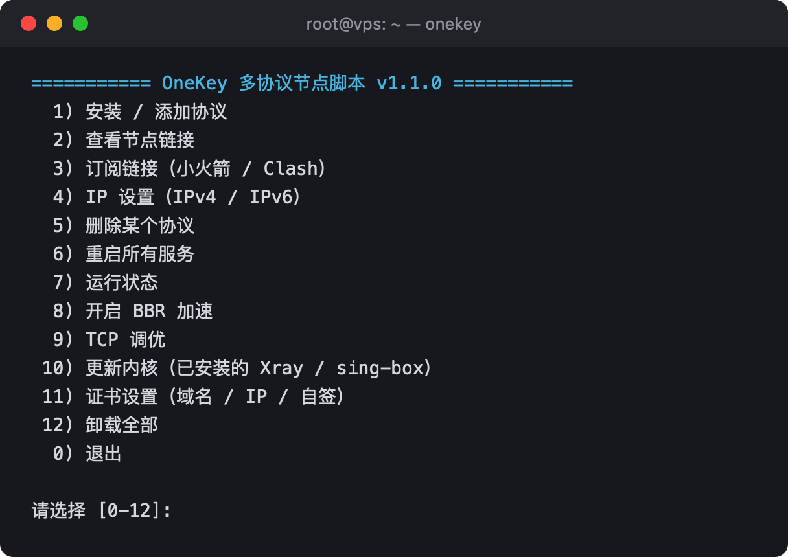
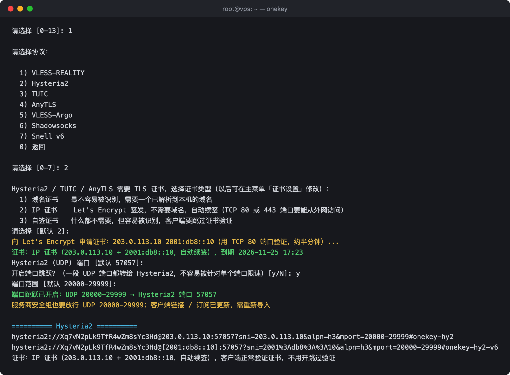
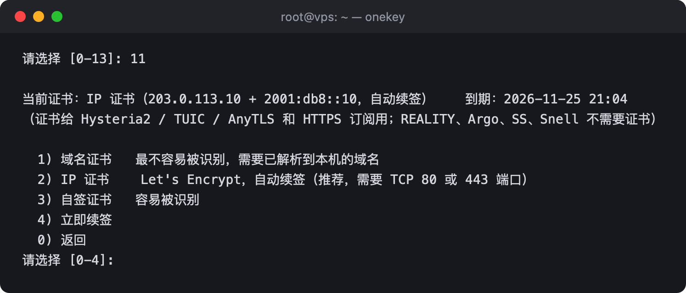
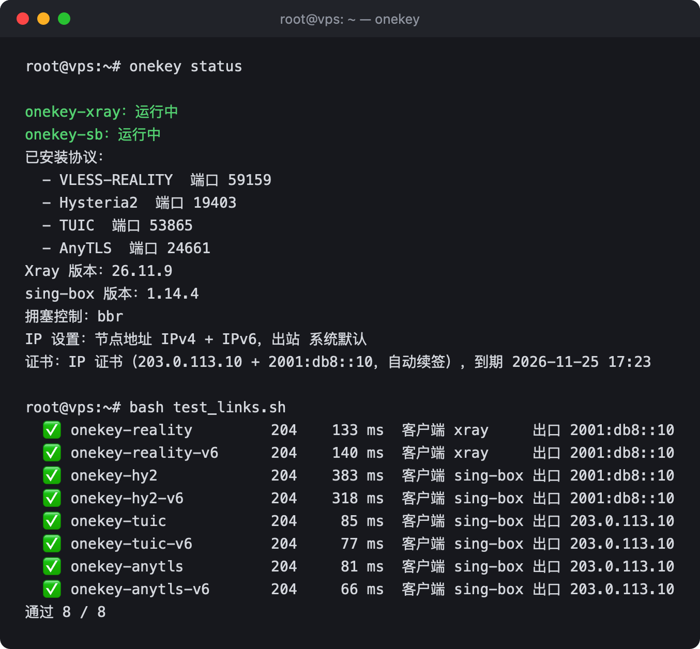

# OneKey · 多协议节点一键脚本

一行命令在 VPS 上搭好代理节点。数字菜单操作，自动生成分享链接、二维码、Clash 配置和订阅地址，小火箭 / Clash / v2rayN / Surge 都能直接导入。

- **7 种协议**：VLESS-REALITY、Hysteria2、TUIC、AnyTLS、VLESS-Argo、Shadowsocks、Snell v6
- **双内核按需安装**：Xray 支持的协议用 Xray，不支持的用 sing-box；选了协议才下载内核，不用了自动删除；**Xray 版本可选**（兼容版 v26.6.27 / 最新版 / 指定版本）
- **随机端口**（10000–60000），自动避开已占用端口
- **IPv4 / IPv6 可选**：节点链接用 IPv4 + IPv6 / 只用 IPv4 / 只用 IPv6；出站可选优先或只用 IPv4 / IPv6
- **三种证书**：域名证书 / IP 证书（默认，Let's Encrypt，自动续签，和 3x-ui 一样）/ 自签证书；80 端口不行自动改用 443 验证，快过期时菜单里红字提醒
- **一键导入**：分享链接 + 二维码、Clash（mihomo）配置、带随机密钥的订阅链接；有 IP / 域名证书时订阅自动走 HTTPS
- **Hysteria2 端口跳跃**：一段 UDP 端口都转给 Hysteria2，客户端轮换端口
- **一键更新**：`onekey update` 更新脚本，`onekey update-core` 更新内核
- **TCP 调优**：BBR + fq + 按内存自动调整缓冲区，可一键恢复
- **干净卸载**：程序、配置、服务、内核参数全部还原

<p align="center"></p>

## 快速开始

用 root 登录 VPS，运行：

```bash
bash <(curl -Ls https://raw.githubusercontent.com/Aurivian11/onekey/main/install.sh)
```

装好后，以后在服务器上输入 `onekey` 就能打开菜单。

1. 选 **1 安装 / 添加协议**，选协议，端口直接回车（随机）。
2. 安装完自动显示每个节点的链接和二维码，小火箭直接扫码导入。
3. Clash 用户：查看链接时按回车开启订阅，会显示 Clash 订阅地址、`clash://` 一键导入链接和二维码（菜单 3 也能随时查看）。

以安装 Hysteria2 为例：选协议 → 选证书（回车默认 IP 证书）→ 端口回车 → 选择是否开端口跳跃，自动申请证书并输出链接：

<p align="center"></p>

## 支持的协议

| 协议 | 内核 | 传输 | 说明 |
|---|---|---|---|
| VLESS-REALITY | Xray | TCP | Vision 流控，伪装 `www.amd.com`，免域名免证书 |
| Hysteria2 | Xray | UDP | 默认 IP 证书，见下方「证书」；可开端口跳跃 |
| VLESS-Argo | Xray + cloudflared | 不开端口 | 走 Cloudflare 隧道隐藏服务器 IP；支持临时隧道或固定隧道（Token + 自己的域名） |
| Shadowsocks | Xray | TCP+UDP | 默认 2022-blake3-aes-128-gcm，也可选 aes-256-gcm / chacha20-ietf-poly1305；适合当中转落地（安装时会显示明文参数） |
| TUIC v5 | sing-box | UDP | Xray 不支持；BBR 拥塞控制；默认 IP 证书 |
| AnyTLS | sing-box | TCP | Xray 不支持；默认 IP 证书 |
| Snell v6 | 官方 snell-server | TCP | 仅 Surge 等支持 Snell v6 的客户端 |

内核只在选择对应协议时下载（Xray / sing-box 来自 GitHub 官方 Release，snell-server 来自 dl.nssurge.com，cloudflared 来自 Cloudflare 官方 Release）；某个内核不再被任何协议使用时会被自动删除。

## 导入客户端

| 客户端 | 导入方式 | 可用节点 |
|---|---|---|
| 小火箭 Shadowrocket | 扫每个节点的二维码 / 复制链接自动识别 / 扫「小火箭订阅」二维码一次导入全部 | 除 Snell 外 |
| Clash Verge Rev / Clash Meta for Android / Stash | 打开 `clash://install-config?url=…` 一键导入链接 / 扫 Clash 订阅二维码 / 粘贴「Clash 订阅」地址 | 除 Snell 外 |
| v2rayN / NekoBox / sing-box App | 复制链接或「小火箭订阅」地址 | 除 Snell 外 |
| Surge | 把菜单 2 里的 Snell 行粘贴到 `[Proxy]` | Snell v6 |

- Clash 配置自带「节点选择」「自动选择（测速择优）」两个分组，国内直连、国外走代理。
- 订阅由服务器上的 busybox httpd 提供，地址带 32 位随机密钥；目录不可浏览，密钥错误返回 404。
- **有 IP / 域名证书时订阅自动走 HTTPS**（socat 用同一张证书加密），传输中别人看不到节点密码；只有自签证书或没有证书时才是明文 HTTP。HTTP 和 HTTPS 切换时订阅地址会变，脚本会提示新地址。
- 订阅地址等于全部节点的密码，泄露后用「更换订阅地址」让旧地址失效。
- 请用 mihomo 内核的 Clash（如 Clash Verge Rev），原版 Clash 不支持 REALITY / Hysteria2 / TUIC / AnyTLS。

> **REALITY 兼容性（2026-11 实测）**：Xray 从 v26.7.11 起，REALITY 服务端与 sing-box 内核、mihomo（Clash Meta）内核的客户端不兼容，Xray 内核客户端（如 v2rayN）可正常连接；其它协议不受影响。脚本默认装**兼容版 v26.6.27**，Xray / sing-box / mihomo 内核客户端都能连，见下方「Xray 版本」。

## 当中转落地（配合 relay）

装 Shadowsocks 时除了链接，还会显示明文参数（地址 / 端口 / 加密 / 密码，3x-ui 出站手动填用），以及一行给中转机用的命令：

```
在中转机上一键加线路（relay 中转脚本，github.com/Aurivian11/relay）：
  command -v relay >/dev/null || bash <(curl -Ls https://raw.githubusercontent.com/Aurivian11/relay/main/relay.sh) </dev/null; LAND='ss://...' relay add
```

复制到中转机运行，就生成一条「我 → 中转机 → 这台落地」的 VLESS-REALITY 线路。两层中转、备用落地自动切换、订阅等见 [relay](https://github.com/Aurivian11/relay)。

## IP 设置（IPv4 / IPv6）

菜单 **4**，两项可分别设置：

| 设置 | 选项 | 作用 |
|---|---|---|
| 节点地址 | IPv4 + IPv6 / 只用 IPv4 / 只用 IPv6 | 决定链接、二维码、Clash 配置、订阅里用哪个 IP。第一次安装协议时会询问（服务器同时有 IPv4 和 IPv6 时） |
| 出站 | 系统默认 / 优先 IPv4 / 优先 IPv6 / 只用 IPv4 / 只用 IPv6 | 通过节点访问网站时，对方看到的是服务器的 IPv4 还是 IPv6（Xray、sing-box、Snell 同时生效） |

- 修改「节点地址」后链接会变，客户端需要重新导入或更新订阅；修改「出站」不影响链接。
- VLESS-Argo 始终使用 Cloudflare 隧道域名，不受「节点地址」影响。

## 证书（Hysteria2 / TUIC / AnyTLS / HTTPS 订阅）

第一次安装这三个协议之一时选择，以后在菜单 **11** 随时切换。REALITY、Argo、SS、Snell 不需要证书。

<p align="center"></p>

| 证书 | 隐蔽性 | 条件 | 客户端 |
|---|---|---|---|
| 域名证书 | 最好 | 一个已解析到本机的域名（Cloudflare 要关小黄云） | 正常验证证书 |
| **IP 证书（默认）** | 较好 | 不需要域名；TCP 80 或 443 端口能从外网访问 | 正常验证证书 |
| 自签证书 | 差，主动探测一眼能认出 | 无 | 必须开「跳过证书验证」 |

- 域名证书和 IP 证书都用 [acme.sh](https://github.com/acmesh-official/acme.sh) 向 Let's Encrypt 申请。IP 证书是 Let's Encrypt 的短期证书（约 6 天），脚本设置为每 3 天自动续签一次，续签后自动重启内核和订阅服务；域名证书 90 天，到期前 30 天续签。
- 申请时先用 **TCP 80** 验证；80 被占用或不通时自动改用 **TCP 443**（TLS-ALPN 验证）。哪种成功，以后续签就沿用哪种。两个端口都不行才会失败。
- **双保险**：除了 acme.sh 自己的续签，脚本每天还会检查一次；IP 证书剩不到 2 天（域名证书剩不到 20 天）说明续签失败了，会自动按原类型重新申请。
- **过期提醒**：证书 2 天内到期或已过期时，打开菜单、`onekey status`、`onekey cert` 都会显示红字警告和原因。
- **不用就停**：删掉最后一个用证书的协议（并且订阅已关闭）时自动停止续签，不浪费 Let's Encrypt 的申请次数；以后再装 Hysteria2 / TUIC / AnyTLS 时按原来的类型自动重新申请，不再询问。
- 节点地址设为 IPv4 + IPv6 时，IP 证书会同时包含两个 IP；IPv6 验证不通过时自动只申请 IPv4，此时 IPv6 链接会跳过证书验证。
- 申请失败时会自动先用自签证书，节点照常可用，之后可在菜单 11 重新申请。
- 换证书后链接里的 SNI / 跳过验证会变，客户端需要重新导入或更新订阅。
- 1.0 版装的节点保持自签证书不变，想换就在菜单 11 选择。

## Hysteria2 端口跳跃

安装 Hysteria2 时可选择开启，以后在菜单 **12** 开启、改范围或关闭。

- 用 nftables 把一段 UDP 端口（默认 20000–29999，和其它协议的端口冲突时自动换一段）全部转给 Hysteria2 的端口，客户端每隔一段时间换一个端口连接，不容易被针对单个端口限速或封锁。
- 链接里加 `mport=范围`，Clash 配置里加 `ports` 和 `hop-interval`；支持的客户端（Clash Meta / mihomo、sing-box、v2rayN 等）会自动轮换端口，不支持的照常用单端口。
- 规则由 `onekey-hop` 服务开机自动加载；删除 Hysteria2 或卸载时自动清除。
- **服务商的安全组 / 防火墙要放行这一段 UDP 端口。**
- 部分 OpenVZ / LXC 小鸡不能用 nftables，这时无法开启，Hysteria2 照常用单端口。

## 更新

菜单 **10**，或命令行：

```bash
onekey update        # 更新脚本本身（节点参数和链接不变，会自动按新版规则更新服务）
onekey update-core   # 更新内核：sing-box 换成最新版，Xray 按下面的「Xray 版本」设置（会短暂断线）
```

内核不会自动更新，需要时手动运行。

## Xray 版本

第一次装用到 Xray 的协议（REALITY / Hysteria2 / SS / Argo）时选择，以后在菜单 **10 → 3** 或用 `onekey xray` 修改：

| 选项 | 版本 | REALITY 能连的客户端 |
|---|---|---|
| **兼容版（默认）** | 固定 v26.6.27 | Xray 内核（v2rayN 等）、sing-box 内核（sing-box App、NekoBox 等）、mihomo 内核（Clash Verge Rev、Clash Meta for Android 等）都能连 |
| 最新版 | 跟随 Xray 最新正式版 | 只有 Xray 内核客户端；sing-box / mihomo（Clash Meta）内核连不上 |
| 指定版本号 | 自己填，如 v26.3.27 | — |

```bash
onekey xray                 # 查看当前版本和设置
onekey xray compat          # 换成兼容版 v26.6.27
onekey xray latest          # 换成最新版
onekey xray v26.3.27        # 换成指定版本
```

- 只影响 VLESS-REALITY；Hysteria2 / SS 在两个版本上都实测正常。
- 2026-11 实测（Debian 13）：兼容版上 REALITY 用 Xray v26.6.27、sing-box 1.14.4、mihomo v1.19.34 三种客户端都通过；最新版 v26.11.9 上 sing-box 和 mihomo 都报 REALITY 验证失败。
- 兼容版和指定版本「固定」不变，`onekey update-core` 不会把它升级。
- 换版本时先下载、确认能运行再替换；版本号不存在或新版本起不来会自动换回原来的版本，节点链接不变。
- 1.2 及以前装的服务器保持原来的最新版，想换就运行 `onekey xray compat`。

## TCP 调优

菜单 **9** 可选：应用推荐调优 / 查看当前参数 / 恢复调优前的参数。

- BBR 拥塞控制 + fq 队列
- 收发缓冲区按内存自动调整：≤512M → 8MB，1G → 16MB，2–4G → 32MB，更大 → 64MB（同时满足 Hysteria2 / TUIC 对 UDP 缓冲区的要求）
- TCP Fast Open、MTU 探测、空闲后不降速、`tcp_notsent_lowat` 降低延迟、更大的连接队列
- 第一次调优前自动备份原始值，「恢复」一键还原；卸载时自动恢复

## 命令行用法

```bash
onekey                      # 打开菜单
onekey add reality          # 非交互安装：reality | hy2 | tuic | anytls | argo | ss | snell
PORT_SET=443 onekey add reality
METHOD=aes-256-gcm onekey add ss
SNI=www.microsoft.com onekey add reality
IP_MODE=6 onekey add hy2        # 第一次安装时直接指定只用 IPv6（4 | 6 | both）
CERT=self onekey add tuic       # 第一次装 Hysteria2 / TUIC / AnyTLS 时指定证书（ip 默认 | domain | self）
CERT=domain DOMAIN=example.com onekey add hy2
HOP_RANGE=on onekey add hy2     # 安装 Hysteria2 时开启端口跳跃（on 用默认范围，也可写 20000-29999）
XRAY_VER=latest onekey add reality  # 第一次装 Xray 时指定版本（compat 默认 | latest | v26.x.y）
onekey links                # 查看全部链接
onekey sub                  # 开启订阅 / 查看订阅地址（sub reset 换地址，sub off 关闭）
onekey clash                # 输出 Clash 配置
onekey remove hy2           # 删除某个协议
onekey status               # 运行状态
onekey tcp                  # TCP 调优（tcp show 查看，tcp restore 恢复）
onekey bbr                  # 只开 BBR
onekey rebuild              # 按当前规则重新生成内核配置
onekey ip                   # 查看 IP 设置
onekey ip 6                 # 节点链接只用 IPv6（4 只用 IPv4，both 两个都生成）
onekey ip out prefer6       # 出站优先 IPv6（auto | prefer4 | prefer6 | only4 | only6）
onekey cert                 # 查看证书和到期时间
onekey cert ip              # 换成 IP 证书（domain <域名> 换域名证书，self 换自签）
onekey cert renew           # 立即续签
onekey hop on               # Hysteria2 端口跳跃：on 默认范围 / 20000-29999 指定范围 / off 关闭
onekey update               # 更新脚本
onekey update-core          # 更新内核（Xray 按版本设置）
onekey xray compat          # Xray 换成兼容版 v26.6.27（latest 最新版，或写具体版本号）
onekey uninstall            # 卸载全部
```

## 测试工具

`test_links.sh` 会读取脚本生成的分享链接，在服务器上逐个连接并访问 `generate_204`，检查每条链接是否可用（REALITY 用 Xray 和 sing-box 两种客户端都测，其它用 sing-box 客户端测；链接没写跳过证书验证时会真正校验证书）：

```bash
bash test_links.sh
```

下图是 Debian 13 上 IP 证书模式的实测结果（IPv4 + IPv6 共 8 条链接，Hysteria2 / TUIC / AnyTLS 均开启证书验证）：

<p align="center"></p>

> 截图里的 IP 用文档保留地址（203.0.113.10 / 2001:db8::10）代替，密码均为示例值。

## 系统要求

| 系统 | 状态 |
|---|---|
| Debian 11 / 12 / 13、Ubuntu 20.04+（systemd） | 已在 Debian 13 实测 |
| Alpine（OpenRC） | 已适配，未实测；Snell 会自动安装 `gcompat` |
| CentOS / Rocky / Alma（dnf / yum） | 已适配，未实测；需 OpenSSL 1.1.1+ |

- 架构：amd64、arm64
- 需要 root
- 系统没有 IPv6 时自动只监听 IPv4

## 文件位置

| 路径 | 内容 |
|---|---|
| `/etc/onekey/` | 各协议参数、内核配置、证书、链接、Clash 配置、订阅文件（权限 600） |
| `/usr/local/bin/onekey` | 菜单命令 |
| `/usr/local/bin/xray`、`sing-box`、`snell-server`、`cloudflared` | 按需安装的内核 |
| `onekey-xray` / `onekey-sb` / `onekey-snell` / `onekey-argo` / `onekey-sub` / `onekey-hop` | 系统服务 |
| root 的 crontab | `onekey cert cron` 每天检查一次证书（只在用 IP / 域名证书时存在） |
| `/etc/sysctl.d/99-onekey-tcp.conf` | TCP 调优参数 |
| `/root/.acme.sh/` | acme.sh（IP / 域名证书的申请和续签；卸载时只删本脚本的证书记录，acme.sh 保留） |

## 常见问题

- **连不上**：先确认服务商的防火墙 / 安全组放行了端口（Hysteria2、TUIC 是 UDP）；菜单 7 看服务是否在运行。
- **Hysteria2 / TUIC / AnyTLS 报证书错误**：`onekey cert` 看证书是否过期；IP / 域名证书续签失败多半是 TCP 80 和 443 都被占用或被防火墙拦了，处理后 `onekey cert renew`。
- **Hysteria2 端口跳跃连不上**：确认服务商安全组放行了整段 UDP 端口；`onekey hop` 查看范围。自签证书需要客户端打开「跳过证书验证 / allowInsecure」。
- **Argo 链接失效**：临时隧道在服务器或服务重启后域名会变，菜单 2 重新查看；订阅会自动更新。
- **想换伪装网站**：重新添加 REALITY 时在「伪装域名 (SNI)」填其它支持 TLS 1.3 的大站。

## 免责声明

本项目仅供学习和研究网络技术使用。请遵守你所在地区以及服务器所在地的法律法规，使用本脚本产生的一切后果由使用者自行承担。
